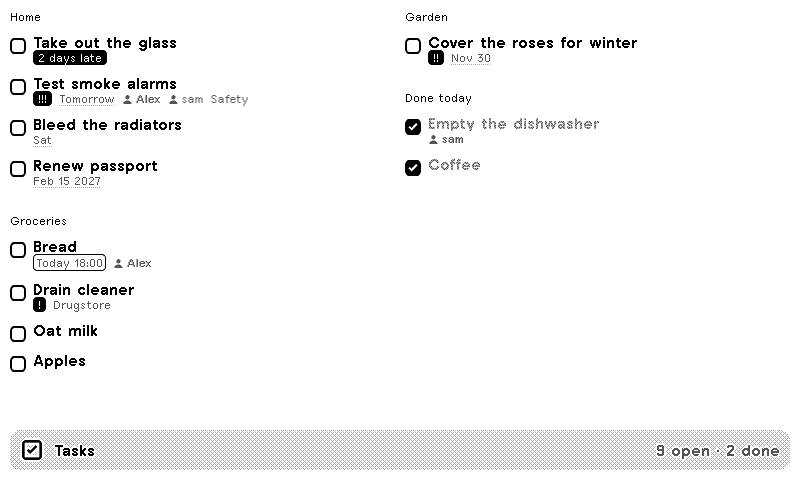
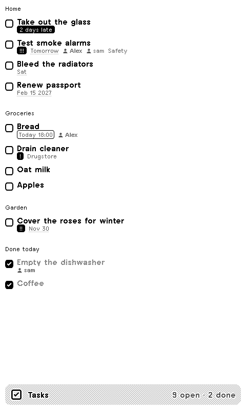
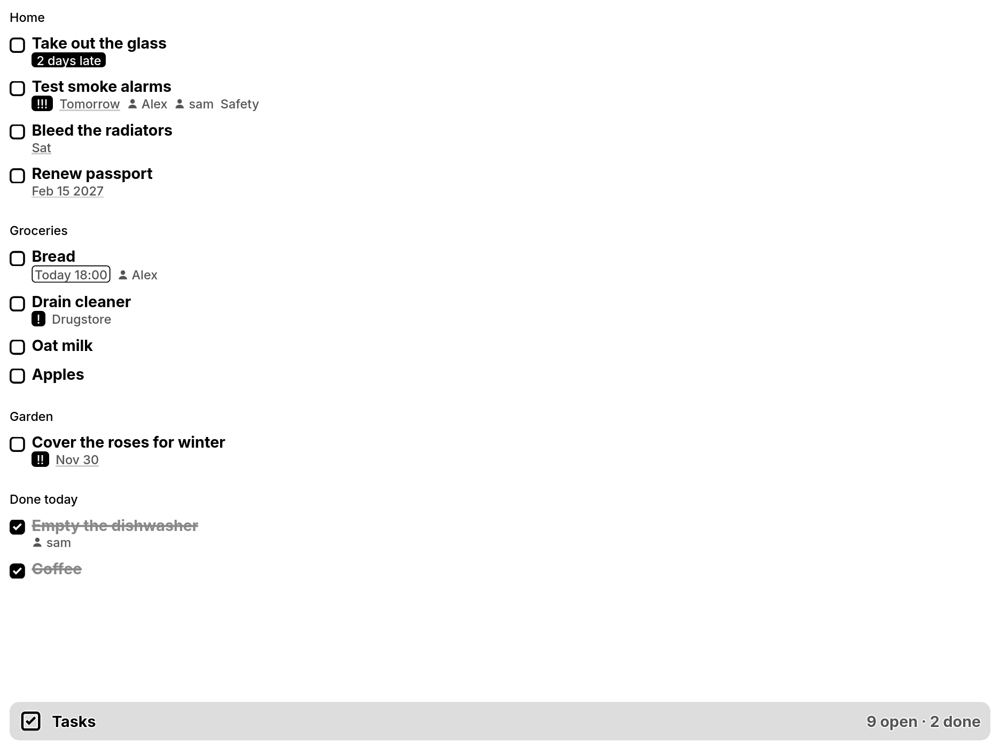
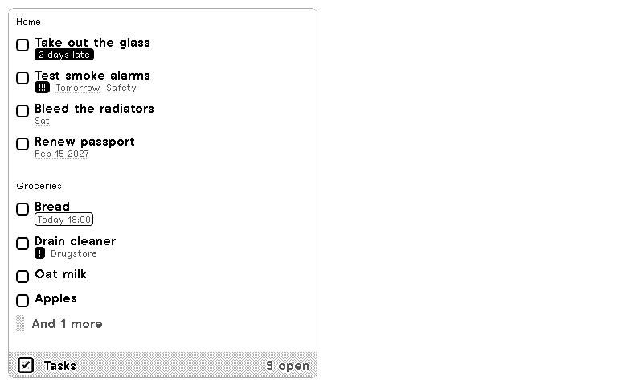
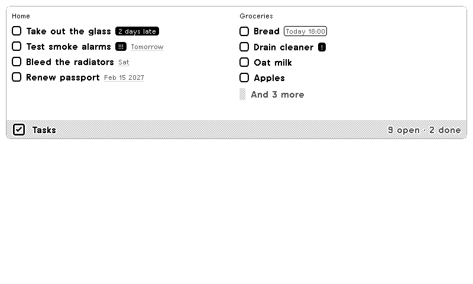
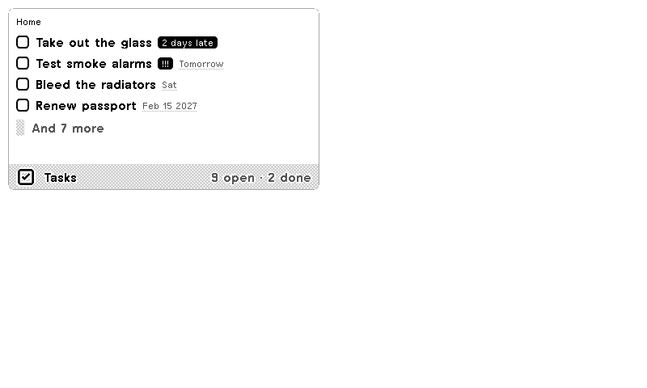

# Vikunja Tasks

The open tasks of your [Vikunja](https://vikunja.io) as a calm checklist on [TRMNL](https://trmnl.com) e-paper displays: a box for every task, the most pressing first, due dates in plain words, priority marks for what is urgent and who each task belongs to. What you tick off today stays on the list, ticked, until midnight.



| Portrait | TRMNL X | Half (vertical) |
|---|---|---|
|  |  |  |

| Half (horizontal) | Quadrant |
|---|---|
|  |  |

## Features

- One project, several or all, chosen by name or ID; with several, tasks are grouped under their project
- Due dates as *Today 18:00*, *Tomorrow*, *Sat* or *2 days late*: late tasks filled black, today outlined
- Vikunja priority 3 to 5 as `!` to `!!!`, task labels optional
- Assignees by first name (or username)
- **Done today**: tasks ticked off today stay on the list with a ticked box and struck through, until midnight
- **Focus mode**: only what is late or due today or tomorrow
- Order by due date, priority, title or age
- An extra [Vikunja filter](https://vikunja.io/docs/filters) on top, e.g. `due_date < now+7d` or `priority >= 3`
- Clear screens for *all done*, a rejected token or an unreachable server
- German or English (or follow the TRMNL account language)
- All four TRMNL layouts, in landscape and portrait, on TRMNL OG and TRMNL X; long lists flow into a second column and end with "and N more"

Read only: the plugin never changes anything in Vikunja.

## Setup

1. In Vikunja, open **Settings → API Tokens** and create a token with only these two permissions: **Projects → Read All** and **Tasks → Read All**. Nothing else is needed: labels and assignees come with the tasks.
2. Add the plugin to TRMNL and paste the token.
3. Self-hosted: enter your Vikunja address, e.g. `https://tasks.example.com`. Empty means Vikunja Cloud. TRMNL fetches the tasks from its servers, so the address must be reachable from the internet.
4. Optional: projects (`Groceries, Home` or `12, 14`), an extra filter, order, title.

Without a token the plugin shows sample tasks.

## Settings

| Setting | Default | |
|---|---|---|
| Vikunja address | Vikunja Cloud | Base URL of your Vikunja, without `/api/v1` |
| API token | – | Permissions: Projects → Read All, Tasks → Read All |
| Projects | all | Names or IDs, comma separated |
| Extra filter | – | Vikunja filter syntax, combined with "not done" |
| Show | All open tasks | Or focus: late, today, tomorrow |
| Done today | on | Today's ticked-off tasks, at the end |
| Order | Due date | Due date, Priority, Title, Oldest first |
| Group by project | on | Only when more than one project is shown |
| Show labels | on | Up to three labels per task |
| Show assignees | on | Up to three per task |
| Title | project name or "Tasks" | |
| Language | Auto | Auto, Deutsch, English |

The plugin asks for up to 250 open tasks and 250 done today; Vikunja caps each at its `max_items_per_page`, 50 by default. If you have more, narrow the list with projects or the extra filter, e.g. `project in 12, 14`.

## Development

Needs Docker (or `gem install trmnl_preview`).

```bash
bin/trmnlp serve
```

Preview with your own Vikunja instead of sample tasks:

```bash
VIKUNJA_URL=https://tasks.example.com VIKUNJA_TOKEN=tk_… bin/trmnlp serve
```

Tests and lint (also run in CI):

```bash
bin/trmnlp lint
```

```bash
bin/trmnlp test --report report
```

`src/transform.py` turns Vikunja's answer into what the views show; `src/shared.liquid` holds the list markup, the four view files only pick the layout. Built with the [TRMNL Framework](https://trmnl.com/framework) and [trmnlp](https://github.com/usetrmnl/trmnlp).

## License

MIT, see [LICENSE](LICENSE). Vikunja is a trademark of its authors; this plugin is not affiliated with Vikunja.
